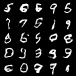

# Assignment 3: MNIST GAN

For this assignment, I implemented a GAN in PyTorch to generate handwritten
digits from MNIST and added an image generation endpoint to my existing
FastAPI application. The application can also run in Docker.

The text generation, word embedding, and CIFAR-10 classification endpoints
from my previous assignments are preserved.

## Project files

| File | Description |
| --- | --- |
| `app/helper_lib/model.py` | Generator, Discriminator, GAN, and `get_model` |
| `app/helper_lib/trainer.py` | GAN training function |
| `app/helper_lib/generator.py` | Image generation and sample-grid display |
| `app/gan_model.py` | Loading the trained GAN |
| `app/main.py` | FastAPI application and endpoints |
| `app/mnist_generator.pth` | Generator weights trained for 20 epochs |
| `train_gan.py` | MNIST training script |
| `Assignment3_GAN.ipynb` | Notebook for training and displaying samples |
| `gan_samples.png` | Sample grid from the completed training run |
| `THEORY_ANSWERS.md` | Answers to Questions 1–7 |
| `Dockerfile` | Docker deployment configuration |
| `pyproject.toml` and `uv.lock` | Application dependencies |
| `requirements-training.txt` | Additional training dependencies |

## Model architecture

### Generator

The generator takes a random noise vector and produces a 28 × 28
grayscale image.

1. Input noise: `(B, 100)`.
2. Linear layer: 100 → 6272.
3. Reshape to `(B, 128, 7, 7)`.
4. ConvTranspose2d: 128 → 64, kernel size 4, stride 2, padding 1.
5. BatchNorm2d and ReLU.
6. ConvTranspose2d: 64 → 1, kernel size 4, stride 2, padding 1.
7. Tanh activation.

Output shape: `(B, 1, 28, 28)`.

### Discriminator

The discriminator takes a grayscale image and outputs a real/fake
probability.

1. Input image: `(B, 1, 28, 28)`.
2. Conv2d: 1 → 64, kernel size 4, stride 2, padding 1.
3. LeakyReLU with a negative slope of 0.2.
4. Conv2d: 64 → 128, kernel size 4, stride 2, padding 1.
5. BatchNorm2d and LeakyReLU with a negative slope of 0.2.
6. Flatten.
7. Linear layer: 6272 → 1.
8. Sigmoid activation.

Output shape: `(B, 1)`.

## Training method

I normalized MNIST images to [-1, 1] to match the generator's Tanh output.
I used binary cross-entropy loss and alternated between updating the
discriminator and the generator.

During the discriminator update, real images have a target of 1 and
generated images have a target of 0. Generated images are detached from
the generator's computation graph for this update.

During the generator update, generated images have a target of 1 because
the generator tries to make the discriminator classify them as real.

The class notebook demonstrates a WGAN trained on CelebA. For this
assignment, I adapted the architecture for 28 × 28 grayscale MNIST images
and used a Sigmoid discriminator output with the standard GAN loss
introduced in the notebook. I kept RMSprop as the optimizer.

### Training configuration

| Setting | Value |
| --- | --- |
| Dataset | MNIST training split: 60,000 images |
| Noise dimension | 100 |
| Batch size | 128 |
| Epochs | 20 |
| Optimizer | RMSprop for both networks |
| Learning rate | 0.00005 for both networks |
| Loss function | BCELoss |
| Image normalization | [-1, 1] |

This is an unconditional GAN. It generates random handwritten digits
without taking a digit label as input.

## Generated samples

The following grid contains 25 images generated after training:



The samples show different digit shapes, although some have incomplete
or distorted strokes.

## Run with Docker

Docker Desktop or another working Docker installation is required.

The trained generator weights are included in
`app/mnist_generator.pth`, so retraining is not required to use the API.

Run these commands from the project root:

```bash
docker build -t assignment3-gan .
```

```bash
docker run --rm -p 8001:80 assignment3-gan
```

Once the application has started, open:

- API documentation: http://127.0.0.1:8001/docs
- Generate 10 digits: http://127.0.0.1:8001/gan/generate?num_samples=10

To save the response as a PNG:

```bash
curl --fail "http://127.0.0.1:8001/gan/generate?num_samples=10" -o generated_digits.png
```

The first build requires internet access to download dependencies,
including the spaCy English model used by the existing embedding endpoint.

The container uses CPU inference. It does not download MNIST or train
the GAN when the server starts.

If port 8001 is already occupied, use another host port:

```bash
docker run --rm -p 8002:80 assignment3-gan
```

Then use port 8002 in the browser URL.

To stop the container, press `Control + C` in the terminal running it.

## GAN API endpoint

### GET `/gan/generate`

Query parameter:

| Parameter | Type | Default | Range |
| --- | --- | --- | --- |
| `num_samples` | Integer | 10 | 1–100 |

Example request:

```text
http://127.0.0.1:8001/gan/generate?num_samples=10
```

The response is a PNG containing a grid of generated digit images.
Each request uses new random noise, so the generated images can differ.

If the generator weights are missing, the endpoint returns HTTP 503
with instructions to train the model.

## Run locally

Local setup requires Python 3.12 and uv.

From the project root, install the application dependencies:

```bash
uv sync --frozen
```

Start the development server:

```bash
uv run --frozen fastapi dev app/main.py
```

Open:

- http://127.0.0.1:8000/docs
- http://127.0.0.1:8000/gan/generate?num_samples=10

To stop the server, press `Control + C`.

## Retrain the GAN

The trained weights are included, but the model can be retrained with
the following commands:

```bash
uv sync --frozen
uv pip install -r requirements-training.txt
uv run --no-sync python train_gan.py --epochs 20
```

The `--no-sync` option keeps the additional training dependencies
installed in the project environment.

The script downloads MNIST to `data/` and saves:

- `app/mnist_generator.pth`: generator weights.
- `gan_samples.png`: a grid of 25 generated images.

These files replace the previous training outputs. Rebuild the Docker
image after retraining to use the updated weights in the container.

The notebook `Assignment3_GAN.ipynb` uses the same helper modules for
training and sample display. Run it from the project root using an
environment with the project and training dependencies installed.
Running the training script and the notebook is not required; either
can be used to train the model.

## Existing API endpoints

| Method | Endpoint | Function |
| --- | --- | --- |
| GET | `/` | Root endpoint |
| POST | `/generate` | Bigram text generation |
| GET | `/embedding?word=apple` | Word embedding |
| POST | `/classify-image` | CIFAR-10 image classification |
| GET | `/gan/generate?num_samples=10` | MNIST digit generation |

The existing endpoints can also be accessed through `/docs`.

## Testing

I trained the model for 20 epochs and inspected the generated sample grid.
I then tested the image generation endpoint locally and inside Docker.
The Docker endpoint returned HTTP 200 and a PNG containing 10 generated
digit images.

I used host port 8001 for Docker because port 8000 was already in use.

## Theory answers

`THEORY_ANSWERS.md` contains my answers to the seven conceptual and
calculation questions, including formulas and intermediate steps.